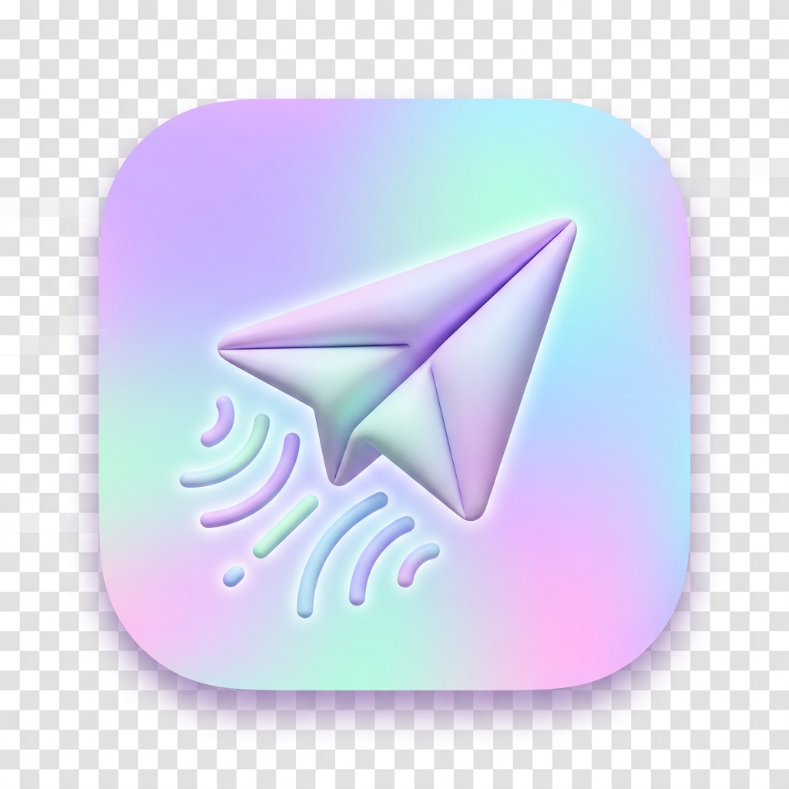
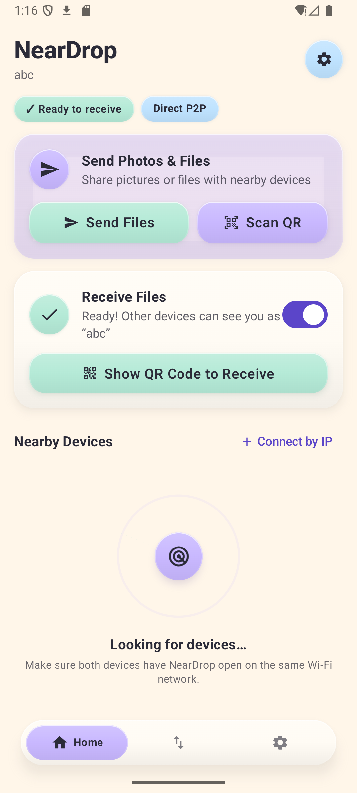
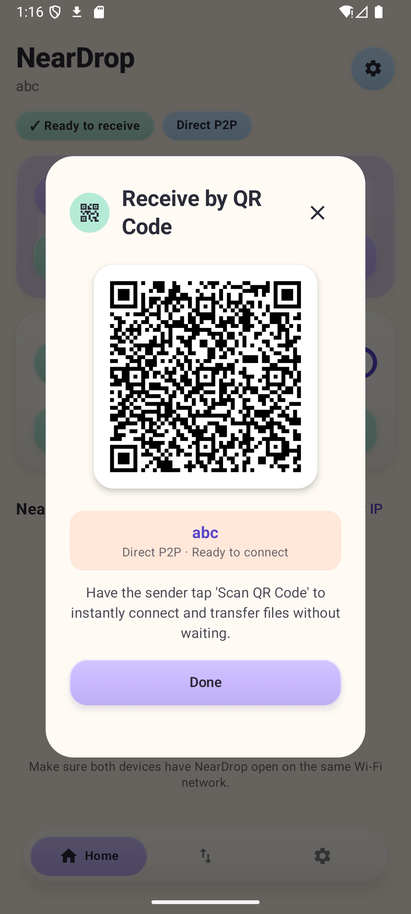
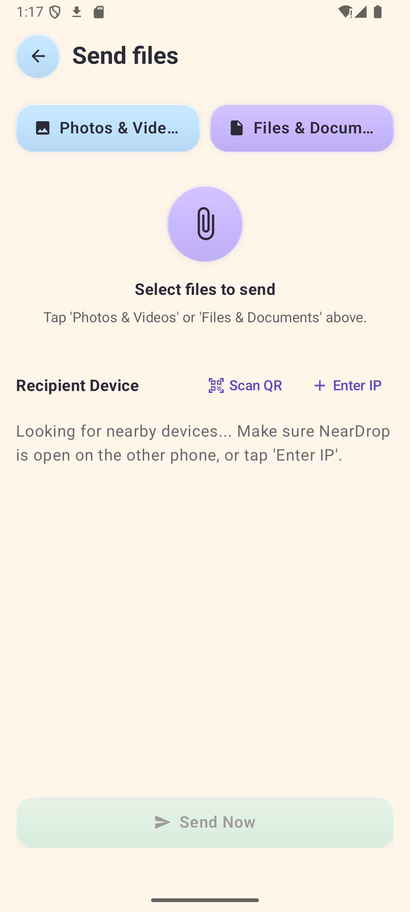
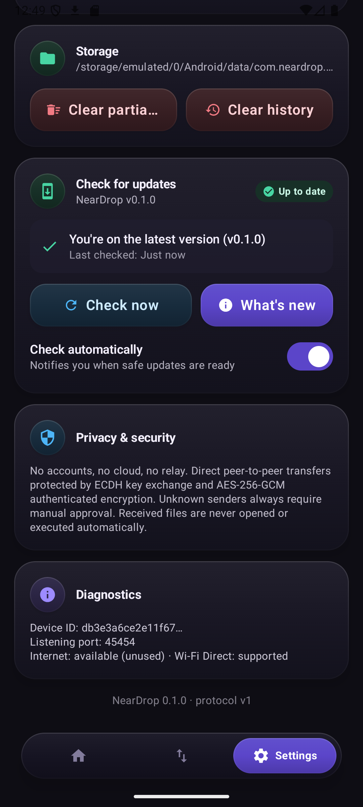

<p align="center">
  
</p>

<h1 align="center">NearDrop</h1>

<p align="center">
  <strong>Fast, private, and effortless offline file sharing for Android.</strong><br>
  Instant QR Code Pairing • Zero Cloud • No Tracking • 100% Peer-to-Peer
</p>

<p align="center">
  <a href="https://github.com/Kmrr-Gautam/NearDrop/releases"></a>
  <a href="https://developer.android.com"></a>
  <a href="https://kotlinlang.org"></a>
  <a href="https://developer.android.com/jetpack/compose"></a>
  <a href="LICENSE"></a>
</p>

---

## 📥 Download APK

Install the verified release APK and start transferring files instantly:

<p align="center">
  <a href="https://github.com/Kmrr-Gautam/NearDrop/raw/main/release/neardrop-v0.1.0.apk">
    
  </a>
</p>

* **Direct Repository Download**: [`release/neardrop-v0.1.0.apk`](https://github.com/Kmrr-Gautam/NearDrop/raw/main/release/neardrop-v0.1.0.apk) *(18 MB)*
* **GitHub Releases**: [NearDrop Releases](https://github.com/Kmrr-Gautam/NearDrop/releases)

---

## ✨ Features

- ⚡ **Instant QR Code Transfer**: The receiver taps **"Show QR Code"**, the sender taps **"Scan QR"**, and the devices connect immediately without waiting for discovery or typing any IP addresses!
- 👴 **Senior-Friendly & Minimal**: Designed with tactile pastel clay cards, high contrast, extra-large touch targets, and zero jargon.
- 📄 **Prominent File Names Everywhere**: Every screen highlights the exact file names, sizes, and file type icons (photos, videos, audio, documents).
- 🔒 **100% Private & P2P**: Direct Wi-Fi / Local Network transfer using hardware-backed ECDH (Elliptic Curve Diffie-Hellman) key agreement and AES-256-GCM authenticated encryption. No accounts, no cloud relays, no tracking.
- 🔄 **Built-in "Check for Updates"**: Software update check integrated directly into Settings with automatic notifications and release notes.
- 🚀 **High Speed & Resumable**: High-throughput raw socket streaming with chunk-level SHA-256 verification and interrupted transfer resume.

---

## 📱 Screenshots

<p align="center">
  
  &nbsp;
  
  &nbsp;
  
  &nbsp;
  
</p>
<p align="center">
  <em>1. Home Screen with QR options • 2. Instant QR Receiver • 3. Senior-Friendly Send Screen • 4. Settings with Software Updates</em>
</p>

---

## ⚡ How to Transfer Files via QR Code

1. **Receiver**: Open NearDrop and tap **Show QR Code to Receive**.
2. **Sender**: Tap **Scan QR** (from the Home screen or Send screen) and point the camera at the receiver's screen.
3. The sender device connects in milliseconds and sends the files directly over the high-speed local network!

---

## 🚀 Installation & Build

### Install on Device
1. Download [`neardrop-v0.1.0.apk`](https://github.com/Kmrr-Gautam/NearDrop/raw/main/release/neardrop-v0.1.0.apk) on your Android device (Android 8.0+).
2. Tap the downloaded file to install and launch NearDrop.

### Build from Source
```bash
git clone https://github.com/Kmrr-Gautam/NearDrop.git
cd NearDrop

# Run test suite
./gradlew :app:testDebugUnitTest

# Build debug APK
./gradlew :app:assembleDebug
```

---

## 🧪 Verified Tests

| Test Suite | Purpose | Status |
| :--- | :--- | :--- |
| `TransferLoopbackTest` | P2P streaming, framing, SHA-256 chunks, resume | ✅ 8/8 Passed |
| `ProtocolTest` | Handshake, message encode/decode, manifest validation | ✅ 8/8 Passed |
| `SecureHandshakeTest` | ECDH key exchange, AES-256-GCM cipher encryption | ✅ 3/3 Passed |
| `NearDropDatabaseTest` | Room database history persistence & migrations | ✅ Passed |

---

## 📄 License

Licensed under the [Apache License, Version 2.0](LICENSE).
